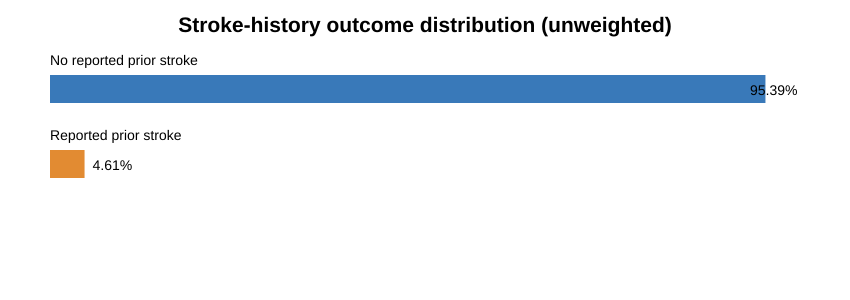
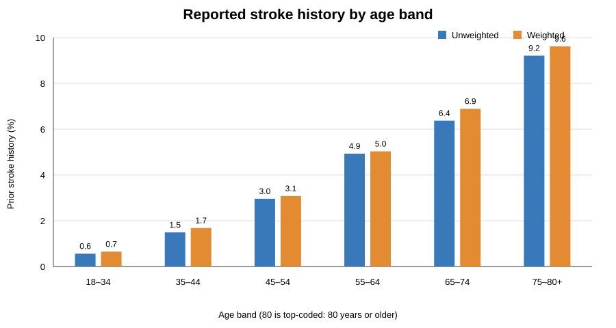
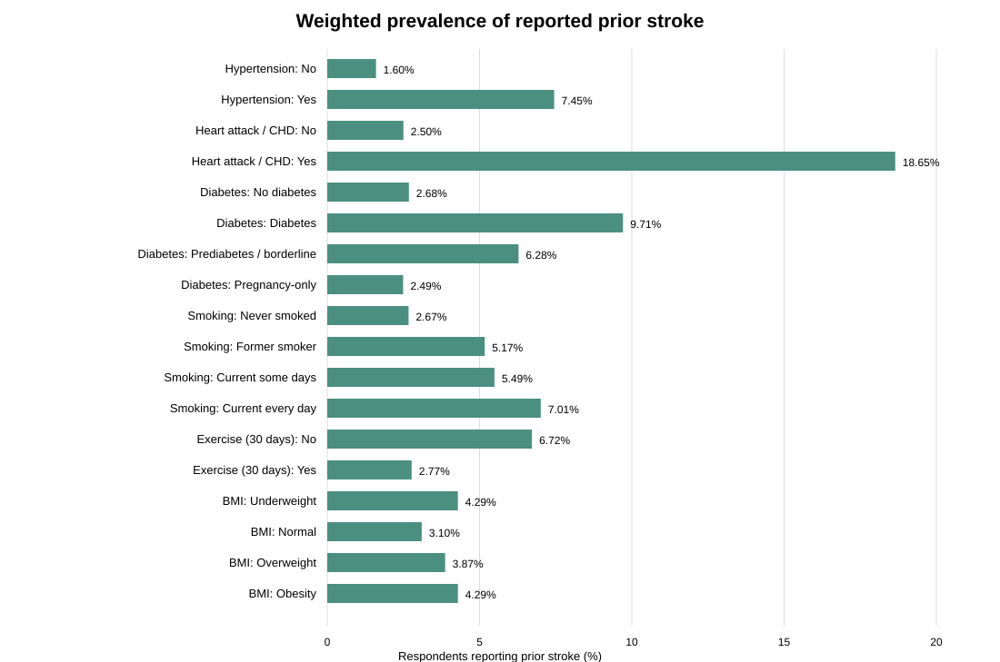
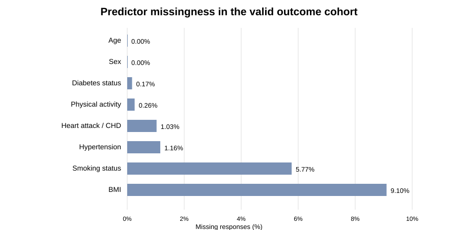

# Exploratory data analysis: BRFSS 2025 stroke-history cohort

**Status:** First-pass descriptive EDA completed. No machine-learning model has been fitted.

## 1. Scope

This analysis uses the locally prepared CDC BRFSS 2025 LLCP cohort. The outcome is the binary recoding of `CVDSTRK3`: code 1 = Yes and code 2 = No, where the survey asks whether a health professional has ever told the respondent that they had a stroke. Codes 7 (Don't know/Not sure), 9 (Refused), and blank responses were excluded from the binary-outcome cohort.

These are descriptive comparisons of **reported prior stroke history**. They do not estimate future stroke incidence, causal effects, or clinical risk. Predictors are recorded at survey time; the dataset does not establish whether a diagnosis or behaviour occurred before or after a stroke.

## 2. Cohort and outcome balance

| Measure | Result |
|---|---:|
| Valid Yes/No outcome records | 354,950 |
| Reported prior stroke (Yes) | 16,353 (4.61% unweighted) |
| No reported prior stroke (No) | 338,597 (95.39% unweighted) |
| Weighted Yes share among valid Yes/No records | 3.66% |
| No-to-Yes class ratio | 20.7 : 1 |
| Exact duplicate rows in prepared extract | 0 |

The weighted percentage is the sum of `_LLCPWT` among Yes records divided by the sum of `_LLCPWT` among valid Yes/No records. Always state the denominator.



The class imbalance is substantial. Accuracy alone would be misleading in model evaluation. Report sensitivity/recall, specificity, precision, F1, PR-AUC, ROC-AUC and the confusion matrix; assess calibration if model scores are interpreted.

## 3. Age pattern

Weighted prevalence of reported prior stroke increases across the age bands. The `_AGE80` field is top-coded; the last band includes respondents aged 80 or older.

| Age band | Respondents | Yes responses | Unweighted prevalence | Weighted prevalence |
|---|---:|---:|---:|---:|
| 18–34 | 60,501 | 339 | 0.56% | 0.65% |
| 35–44 | 44,824 | 670 | 1.49% | 1.68% |
| 45–54 | 47,533 | 1,406 | 2.96% | 3.08% |
| 55–64 | 60,462 | 2,979 | 4.93% | 5.03% |
| 65–74 | 73,553 | 4,687 | 6.37% | 6.89% |
| 75–80+ | 68,077 | 6,272 | 9.21% | 9.62% |



The weighted mean age is 63.23 years among respondents reporting prior stroke and 47.98 years among respondents reporting no prior stroke. Age 80 is top-coded and does not identify the exact age of respondents aged 80 or older.

## 4. Subgroup prevalence

The percentages below are the share **within each non-missing category** who report prior stroke. Weighted figures are descriptive point estimates based on `_LLCPWT`; no design-based confidence intervals or standard errors are calculated here.

| Variable | Category | N | Yes N | Weighted prevalence |
|---|---|---:|---:|---:|
| Sex | Female | 187,134 | 8,545 | 3.56% |
| Sex | Male | 167,816 | 7,808 | 3.77% |
| Hypertension | No | 204,419 | 4,518 | 1.60% |
| Hypertension | Yes | 146,422 | 11,629 | 7.45% |
| Heart attack / CHD history | No | 319,837 | 10,454 | 2.50% |
| Heart attack / CHD history | Yes | 31,456 | 5,444 | 18.65% |
| Diabetes status | No diabetes | 289,990 | 10,341 | 2.68% |
| Diabetes status | Diabetes | 51,559 | 5,176 | 9.71% |
| Diabetes status | Prediabetes / borderline | 10,116 | 684 | 6.28% |
| Diabetes status | Pregnancy-only diabetes | 2,665 | 91 | 2.49% |
| Smoking status | Never smoked | 204,439 | 7,232 | 2.67% |
| Smoking status | Former smoker | 95,741 | 5,728 | 5.17% |
| Smoking status | Current smoker, some days | 10,391 | 685 | 5.49% |
| Smoking status | Current smoker, every day | 23,885 | 1,801 | 7.01% |
| Physical activity (past 30 days) | No | 81,844 | 6,358 | 6.72% |
| Physical activity (past 30 days) | Yes | 272,175 | 9,909 | 2.77% |
| BMI category | Underweight (<18.5) | 5,525 | 319 | 4.29% |
| BMI category | Normal (18.5–24.9) | 95,971 | 4,120 | 3.10% |
| BMI category | Overweight (25–29.9) | 114,536 | 5,356 | 3.87% |
| BMI category | Obesity (≥30) | 106,613 | 5,386 | 4.29% |



### Main descriptive patterns

- Reported heart attack / coronary heart disease history has the largest crude contrast: 18.65% in that category versus 2.50% among respondents without it.
- Reported hypertension: 7.45% versus 1.60%.
- Reported diabetes: 9.71%, compared with 2.68% for no diabetes.
- No leisure-time physical activity in the past 30 days: 6.72%, compared with 2.77% among respondents reporting activity.
- Current daily smoking: 7.01%, compared with 2.67% among never-smokers.
- The sex difference is comparatively small: 3.56% for females and 3.77% for males.
- BMI categories do not show a simple monotonic pattern. The underweight group is smaller (N=5,525); this descriptive pattern should not be over-interpreted.

These are unadjusted cross-sectional comparisons. They do not account for confounding, temporal sequence, or causality.

## 5. Missingness

| Predictor | Missing N | Missing share |
|---|---:|---:|
| BMI | 32,305 | 9.10% |
| Smoking status | 20,494 | 5.77% |
| Hypertension | 4,109 | 1.16% |
| Heart attack / CHD history | 3,657 | 1.03% |
| Physical activity | 931 | 0.26% |
| Diabetes status | 620 | 0.17% |
| Age | 0 | 0.00% |
| Sex | 0 | 0.00% |



Missingness differs somewhat by outcome group. BMI is missing for 9.20% of the no-prior-stroke group and 7.17% of the prior-stroke group; heart attack / CHD history is missing for 0.95% and 2.78%, respectively. Unknown/refused values must remain missing, not be recoded as “No.” Imputation must be fitted on training data only.

## 6. Survey design and data-quality checks

- The prepared cohort has positive, non-missing survey weights.
- It contains 2,090 distinct strata and 19,766 distinct PSU codes.
- After restricting to valid Yes/No outcomes, 94 strata contain only one retained PSU. Before calculating design-based standard errors, we must decide how to handle domain subsetting and singleton PSUs using the BRFSS sampling design documentation.
- The weight distribution is wide (median approximately 318.7; maximum approximately 45,875.1), reinforcing that unweighted and weighted results can differ.
- This first-pass EDA does not calculate design-based standard errors, confidence intervals, p-values, or adjusted associations.

## 7. Implications for model development

1. Preserve the outcome imbalance in evaluation. Compare a majority-class baseline and Logistic Regression baseline before adding tree-based models.
2. Report threshold-sensitive metrics, especially sensitivity/recall and PR-AUC, rather than relying on accuracy.
3. Fit missing-value imputation and encoding only within training folds.
4. Do not resample the full dataset before splitting. If class weights or resampling are tested, apply them only within training folds and compare against an unadjusted baseline.
5. Decide how survey weights, strata and PSUs inform descriptive estimates, validation and any population-level claims. The 94 singleton strata in the valid-outcome domain must be addressed rather than ignored.
6. Review temporal ambiguity: diagnoses or behaviours recorded at survey time may have occurred after a respondent's stroke.
7. Keep interpretation to classification of reported prior stroke history in a US survey. Do not describe it as future stroke-risk prediction or generalize directly to Nigeria.

## 8. Reproducibility

Run the EDA locally from the repository root after generating the prepared extract:

```bash
python -m pip install -r requirements-research.txt
python scripts/eda_brfss.py --input data/processed/brfss2025_stroke_history_analysis.csv.gz
```

Aggregate CSV/JSON outputs and chart renders are written to `reports/generated/`, which is ignored by Git. The script does not export respondent-level rows.

**Boundary:** This is descriptive EDA only. No adjusted statistical model, survey-design variance estimate, machine-learning model, explainability result, or clinical validation has been performed.
